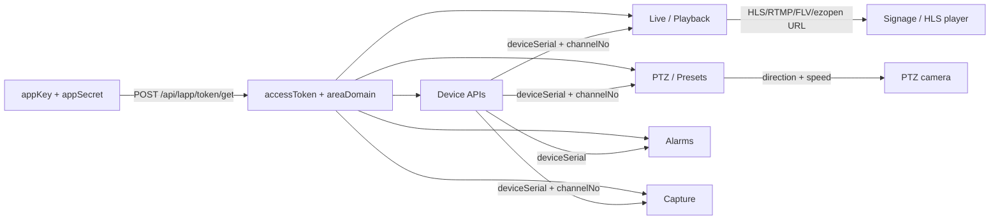

# EZVIZ Open Platform — API Reference

Source of truth: the official docs at `open.ys7.com/help/en/*` (HTTP Interface)
and the PCOpenSDK headers shipped in `EZPCOpenSDK_v5.1.18/inc/`. This file is the
compact, machine-checkable map of the surface this crate implements.

## Flow

## Hosts

| Region | Base URL |
| --- | --- |
| International (default) | `https://isgpopen.ezvizlife.com` |
| Per-account (from `areaDomain`) | e.g. `https://iusopen.ezvizlife.com` |
| China | `https://open.ys7.com` |

All requests are `POST` with `Content-Type: application/x-www-form-urlencoded`.
Every authenticated call carries `accessToken`. The JSON envelope is
`{ "code", "msg", "data"?, "page"? }`; `code == "200"` means success.

## Endpoints

### Auth
| Method | Path | Params | Returns |
| --- | --- | --- | --- |
| POST | `/api/lapp/token/get` | `appKey`, `appSecret` | `accessToken`, `expireTime` (ms), `areaDomain` |

### Device
| Method | Path | Params | Returns |
| --- | --- | --- | --- |
| POST | `/api/lapp/device/list` | `pageStart` (0-based), `pageSize` (≤50) | paged `DeviceInfo[]` |
| POST | `/api/lapp/device/info` | `deviceSerial` | `DeviceDetail` |
| POST | `/api/lapp/device/status` | `deviceSerial` | status (fields vary) |
| POST | `/api/lapp/camera/list` | — | `CameraChannel[]` (all cameras) |
| POST | `/api/lapp/device/camera/list` | `deviceSerial` | `CameraChannel[]` (channels) |

### Live / Playback
| Method | Path | Params | Returns |
| --- | --- | --- | --- |
| POST | `/api/lapp/live/address/get` | `deviceSerial`, `channelNo`, `protocol` (1 ezopen / 2 hls / 3 rtmp / 4 flv), `quality` (1 HD / 2 fluent), `type` (1 preview / 2 local / 3 cloud), `expireTime` (s, 30–720d), `code` (encryption key), `startTime`/`stopTime` (`yyyy-MM-dd HH:mm:ss`) | `LiveAddress { id, url, expireTime }` |
| POST | `/api/lapp/live/address/disable` | `deviceSerial`, `channelNo`, `urlId` | ack |

### PTZ
| Method | Path | Params | Returns |
| --- | --- | --- | --- |
| POST | `/api/lapp/device/ptz/start` | `deviceSerial`, `channelNo`, `direction`, `speed` | ack |
| POST | `/api/lapp/device/ptz/stop` | `deviceSerial`, `channelNo`, `direction` | ack |
| POST | `/api/lapp/device/ptz/mirror` | `deviceSerial`, `channelNo`, `command` (0 up/down, 1 left/right, 2 center) | ack |
| POST | `/api/lapp/device/preset/add` | `deviceSerial`, `channelNo` | `{ index }` |
| POST | `/api/lapp/device/preset/move` | `deviceSerial`, `channelNo`, `index` | ack |
| POST | `/api/lapp/device/preset/clear` | `deviceSerial`, `channelNo`, `index` | ack |

**`direction`** (PTZ start/stop): `0 Up, 1 Down, 2 Left, 3 Right, 4 Upper-left,
5 Lower-left, 6 Upper-right, 7 Lower-right, 8 Zoom in, 9 Zoom out,
10 Focus near, 11 Focus far`.

**`speed`**: `0 Slow, 1 Medium, 2 Fast`.

### Alarms
| Method | Path | Params | Returns |
| --- | --- | --- | --- |
| POST | `/api/lapp/alarm/list` | `startTime`/`endTime` (ms, ≤7 days), `alarmType` (-1 all), `status` (0 unread / 1 read / 2 all), `pageStart`, `pageSize` | paged `AlarmItem[]` |

### Capture
| Method | Path | Params | Returns |
| --- | --- | --- | --- |
| POST | `/api/lapp/device/capture` | `deviceSerial`, `channelNo` | ack |

## Error codes (common)

| Code | Meaning |
| --- | --- |
| 200 | Success |
| 10001 | Parameter empty / wrong format |
| 10002 | accessToken expired / invalid → client auto-refreshes once |
| 10005 | appKey frozen |
| 10007 / 10029 | Call / frequency limit |
| 20002 | Device does not exist |
| 20007 | Device offline |
| 20014 | Illegal deviceSerial |
| 20018 | User does not own the device |
| 20032 | Channel does not exist |
| 60000 / 60001 | Device does not support PTZ / no PTZ permission (encryption on) |
| 60002–60005 | PTZ reached a limit |
| 60006 | PTZ operation failed |
| 60007 / 60008 | No more presets (C6 max 12) |
| 60011 | Preset does not exist |
| 49999 | Platform data exception |

## PCOpenSDK (native, Windows) — `pc-sdk` feature

The SDK (`OpenNetStream.dll`, from `EZPCOpenSDK_v5.1.18`) is loaded at runtime
via `libloading`; the crate never links or redistributes it. Key functions bound
in `src/pc_sdk.rs`:

| SDK function | Purpose |
| --- | --- |
| `OpenSDK_Init` / `OpenSDK_InitLib` | init with appKey (and optional auth/platform hosts) |
| `OpenSDK_SetAccessToken` | set the access token (v5 flow — no password login) |
| `OpenSDK_AllocSessionEx` / `OpenSDK_FreeSession` | session lifecycle |
| `OpenSDK_StartRealPlayEx` / `OpenSDK_StopRealPlayEx` | P2P preview into an HWND (or pure stream) |
| `OpenSDK_PTZCtrlEx` | PTZ command (async; result via message callback) |
| `OpenSDK_SetMessageCallback` | async events: `INS_PTZCTRL_SUCCESS`=46, `INS_PTZCTRL_FAILED`=47, `INS_PTZ_EXCEPTION`=19 |

SDK PTZ command enum (`PTZCommand`): `UP=0, DOWN=1, LEFT=2, RIGHT=3, UPLEFT=4,
DOWNLEFT=5, UPRIGHT=6, DOWNRIGHT=7, ZOOMIN=8, ZOOMOUT=9, FOCUSNEAR=10,
FOCUSFAR=11, IRISSTARTUP=12, IRISSTOPDOWN=13, LIGHT=14, WIPER=15, AUTO=16`.
`PTZAction`: `START=0, STOP=1`.

> The HTTP `direction` codes and the SDK `PTZCommand` codes happen to match for
> 0–11, but keep the two types separate — the HTTP API is the portable path and
> the SDK is the low-latency desktop path.

## Notes / caveats

- `expireTime` in `LiveAddress` is a human-readable string on the intl host.
- `device/status` and `device/info` responses vary by device family; unknown
  fields are preserved via `#[serde(flatten)] extra`.
- The `capture` endpoint is widely used by the official SDKs but is not in the
  public HTTP doc pages; treat it as best-effort.
- The proprietary SDK is **not** redistributable — keep `EZPCOpenSDK_v5.1.18/`
  out of the published crate (it is gitignored here).
